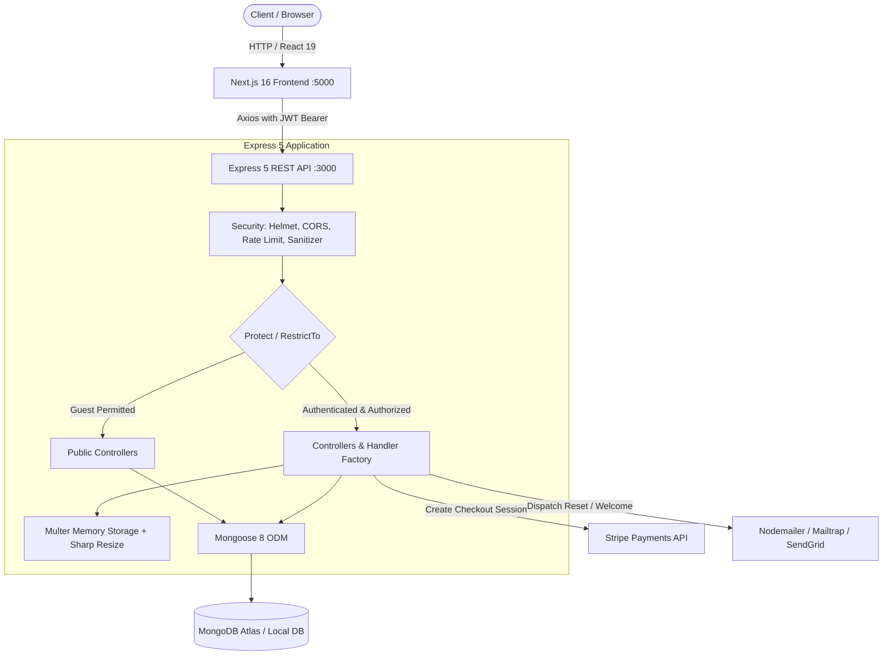

<div align="center">

# TourApp- Adventure Tour Booking Platform

A full-stack, production-ready travel booking platform featuring tour discovery, geospatial inquiries, secure Stripe checkout, and role-based administration.

[](https://nodejs.org/)
[](https://expressjs.com/)
[](https://nextjs.org/)
[](https://react.dev/)
[](https://www.typescriptlang.org/)
[](https://www.mongodb.com/)
[](https://tailwindcss.com/)
[](LICENSE)

[Live Demo Link](https://tour-booking-platform-gamma.vercel.app/)

<br />

</div>

---

## Table of Contents

- [About the Project](#about-the-project)
- [Key Features](#key-features)
- [Tech Stack](#tech-stack)
- [Project Structure](#project-structure)
- [Architecture & How It Works](#architecture--how-it-works)
- [Getting Started](#getting-started)
  - [Prerequisites](#prerequisites)
  - [Installation](#installation)
  - [Environment Variables](#environment-variables)
  - [Database Seeding](#database-seeding)
- [Usage](#usage)
  - [Development Mode](#development-mode)
  - [Production Mode](#production-mode)
- [API Documentation](#api-documentation)
- [Screenshots & Demo](#screenshots--demo)
- [Testing](#testing)
- [Deployment](#deployment)
- [Roadmap & Future Improvements](#roadmap--future-improvements)
- [Contributing](#contributing)
- [License](#license)
- [Author & Contact](#author--contact)

---

## About the Project

TourApp is an end-to-end adventure tour reservation platform built to connect travelers with outdoor expeditions. The platform streamlines the entire booking journey: tourists can discover itineraries with geographic coordinates, filter by difficulty and price, review ratings, and reserve spots using Stripe payments.

For tour operators and administrators, the system provides back-office tools for managing tours, uploading and processing multi-angle imagery, tracking customer reservations, managing reviews, and monitoring business metrics through aggregation pipelines.

---

## Key Features

- 🧭 **Tour Discovery & Catalog**: Filter by difficulty, duration, and price, with text search, multi-field sorting, and pagination.
- 📍 **Geospatial Location Queries**: Locate tours within a specified radius (`/tours-within`) and calculate distance matrices from user coordinates (`/distances`) using MongoDB `2dsphere` indexes.
- 💳 **Stripe Checkout Integration**: Seamless card payments with automated booking confirmation workflows.
- 🛡️ **Robust Authentication & Security**: JWT-based authentication stored in HTTP-only cookies and Authorization headers, bcrypt hashing (cost factor 12), brute-force account lockout with exponential backoff, rate limiting, and NoSQL injection + XSS sanitization.
- 👥 **Role-Based Access Control (RBAC)**: Fine-grained authorization differentiating `user`, `guide`, `lead-guide`, and `admin` permissions across protected resources.
- 🖼️ **Automated Media Processing**: Multer memory storage coupled with Sharp for automated image resizing, format optimization, and cover/gallery asset creation.
- ⭐ **Tour Reviews & Virtual Populates**: Review and rating system preventing duplicate reviews with compound indexes and recalculating average tour ratings dynamically.
- 📊 **Analytics & Monthly Planning**: MongoDB aggregation pipelines calculating tour statistics and monthly tour schedules.
- 📱 **Modern Next.js 16 Frontend**: Reactive user interface built with React 19, TypeScript, Tailwind CSS v4, Lucide icons, and Zustand for global state persistence.

---

## Tech Stack

### Frontend

| Technology          | Badge            | Description                                   |
| :------------------ | :--------------- | :-------------------------------------------- |
| **Next.js 16**      | `Next.js 16.3`   | React Framework with App Router               |
| **React 19**        | `React 19.2`     | Component architecture & client UI            |
| **TypeScript**      | `TypeScript 5`   | Static type safety across client services     |
| **Tailwind CSS v4** | `Tailwind CSS 4` | Utility-first responsive design               |
| **Zustand**         | `Zustand 5`      | Lightweight client auth state store           |
| **Axios**           | `Axios 1.19`     | HTTP client with automatic token interceptors |
| **Lucide React**    | `Lucide Icons`   | Consistent vector iconography                 |

### Backend

| Technology         | Badge            | Description                                      |
| :----------------- | :--------------- | :----------------------------------------------- |
| **Node.js**        | `Node.js 18+`    | JavaScript runtime (ES Modules)                  |
| **Express 5**      | `Express 5.1`    | REST API routing and middleware framework        |
| **Mongoose 8**     | `Mongoose 8.14`  | ODM with schemas, virtuals, and middleware hooks |
| **Multer & Sharp** | `Multer + Sharp` | Multi-file buffer uploads and image pipeline     |
| **Stripe SDK**     | `Stripe 18.5`    | Payment processing and checkout sessions         |
| **Nodemailer**     | `Nodemailer 7`   | Email delivery for welcome & password reset      |

### Database & Storage

| Technology                    | Badge            | Description                                         |
| :---------------------------- | :--------------- | :-------------------------------------------------- |
| **MongoDB**                   | `MongoDB Atlas`  | Document database with geospatial 2dsphere indexing |
| **Local Static Asset Engine** | `Express Static` | Serves optimized tour and avatar image files        |

### Tools & Middleware

| Technology               | Badge                | Description                                                       |
| :----------------------- | :------------------- | :---------------------------------------------------------------- |
| **Helmet**               | `Helmet 8.1`         | HTTP security headers                                             |
| **Rate Limit**           | `express-rate-limit` | Rate limiting to mitigate brute-force and DoS attacks             |
| **XSS & Mongo Sanitize** | `xss`                | Input sanitization against cross-site scripting & NoSQL injection |
| **Compression**          | `compression 1.8`    | Gzip/Brotli payload compression                                   |
| **Nodemon**              | `Nodemon 3.1`        | Local development hot-reload tool                                 |

---

## Project Structure

```text
my-tour-project/
├── backend/                             # Express REST API backend
│   ├── config/                          # Database connection setup
│   │   └── db.js                        # Mongoose MongoDB connection handler
│   ├── configg/                         # Environment config initializer
│   │   └── env.js                       # dotenv loader
│   ├── controllers/                     # Request handling & business logic
│   │   ├── authController.js            # Auth, signup, login, lockout & reset
│   │   ├── bookingController.js         # Stripe checkout & booking CRUD
│   │   ├── errorController.js           # Global error handling middleware
│   │   ├── handlerFactory.js            # Reusable generic CRUD controller factory
│   │   ├── reviewController.js          # Review CRUD & tour link handler
│   │   ├── tourController.js            # Tour CRUD, geo-queries & aggregations
│   │   ├── upload.js                    # Multer configuration for image buffers
│   │   └── userController.js            # User profile & account management
│   ├── dev-data/                        # Sample seed data & import utilities
│   │   └── data/
│   │       ├── import-dev-data.js       # CLI script to seed or clear MongoDB
│   │       ├── tours.json               # Seed dataset for tours
│   │       ├── users.json               # Seed dataset for user accounts
│   │       └── reviews.json             # Seed dataset for tour reviews
│   ├── models/                          # Mongoose schemas & data models
│   │   ├── bookingModel.js              # Booking schema with user/tour population
│   │   ├── reviewModel.js               # Review schema with duplicate prevention
│   │   ├── tourModel.js                 # Tour schema with geospatial indexes
│   │   └── userModel.js                 # User schema with bcrypt & lockout rules
│   ├── public/                          # Static assets served by backend
│   │   └── img/                         # Uploaded user avatars & tour images
│   ├── routes/                          # API route definitions
│   │   ├── bookingsRoutes.js            # /api/v1/bookings endpoints
│   │   ├── reviewRoutes.js              # /api/v1/reviews endpoints
│   │   ├── tourRoutes.js                # /api/v1/tours endpoints
│   │   └── userRoutes.js                # /api/v1/users endpoints
│   ├── santizeData/                     # Custom data security middleware
│   │   ├── sanitizeXSS.js               # XSS defense filter
│   │   └── santizeMongo.js              # NoSQL query injection sanitizer
│   ├── utilis/                          # Shared helper utilities
│   │   ├── apiFeatures.js               # Filtering, sorting, pagination class
│   │   ├── appError.js                  # Custom operational error class
│   │   ├── catchAsync.js                # Async wrapper eliminating try/catch blocks
│   │   ├── email.js                     # Nodemailer email transport class
│   │   └── errorHandlers.js             # Mongoose/JWT operational error handlers
│   ├── app.js                           # Express application & middleware stack
│   ├── package.json                     # Backend dependencies & npm scripts
│   └── server.js                        # HTTP server bootstrap & process listeners
│
├── frontend/                            # Next.js 16 App Router frontend
│   ├── app/                             # Next.js app routes & layouts
│   │   ├── (auth)/                      # Authentication route group
│   │   │   ├── forgot-password/         # Forgot password page
│   │   │   ├── login/                   # Login interface
│   │   │   ├── reset-password/[token]/  # Reset password confirmation
│   │   │   └── signup/                  # New user registration
│   │   ├── admin/                       # Admin dashboard views
│   │   │   ├── bookings/                # Admin booking management
│   │   │   ├── reviews/                 # Admin review moderation
│   │   │   ├── tours/                   # Tour management & tour creation modal
│   │   │   │   └── stats/               # Tour aggregation analytics view
│   │   │   └── users/                   # Admin user & role management
│   │   ├── profile/                     # Authenticated user account views
│   │   │   ├── bookings/                # User personal bookings
│   │   │   ├── change-password/         # Password change interface
│   │   │   ├── reviews/                 # User personal reviews
│   │   │   └── page.tsx                 # Profile details & avatar editor
│   │   ├── tours/[id]/                  # Tour detail page (booking & reviews)
│   │   ├── globals.css                  # Global styling & Tailwind v4 theme
│   │   ├── layout.tsx                   # Root HTML layout with Navbar
│   │   └── page.tsx                     # Main catalog & tour explorer
│   ├── components/                      # Reusable UI components
│   │   ├── layout/                      # Layout components (Navbar)
│   │   └── tours/                       # TourCard, CheckoutModal, TourFormModal
│   ├── lib/
│   │   └── api/
│   │       └── axios.ts                 # Configured Axios instance with interceptors
│   ├── services/                        # API communication layer
│   │   ├── auth.service.ts              # Authentication API calls
│   │   ├── booking.service.ts           # Bookings API calls
│   │   ├── review.service.ts            # Reviews API calls
│   │   ├── tour.service.ts              # Tours API calls
│   │   └── user.service.ts              # User administration API calls
│   ├── store/                           # Client-side state management
│   │   └── useAuthStore.ts              # Zustand auth store with localStorage sync
│   ├── types/                           # TypeScript interfaces
│   │   └── index.ts                     # User, Tour, Review, and Booking types
│   ├── package.json                     # Frontend dependencies & npm scripts
│   └── tsconfig.json                    # TypeScript compiler options
│
└── README.md                            # Comprehensive project documentation
```

---

## Architecture & How It Works

The platform uses a decoupled client-server architecture:

1. **Client Tier (Next.js 16)**: Renders pages and dispatches asynchronous requests through typed services. Authentication credentials and session states are managed using a Zustand store backed by local storage.
2. **Gateway & Security**: Express intercepts requests, parses cookies, validates CORS origins, checks rate limits, sanitizes NoSQL/XSS injections, and injects HTTP security headers via Helmet.
3. **API & Business Logic**: Requests pass through route controllers. Protected actions enforce JWT verification and role matching (`protect` and `restrictTo` middleware).
4. **Data Layer (MongoDB)**: Managed via Mongoose models with pre/post hooks (password hashing, query populates, and automatic slug generation). Geospatial queries leverage 2dsphere indexes.
5. **External Integrations**:
   - **Stripe**: Creates hosted checkout sessions for tour purchases.
   - **Sharp**: Resizes and formats raw multipart/form-data upload buffers before writing to disk.
   - **Nodemailer**: Dispatches transactional emails (welcome messages and password reset tokens).



---

## Getting Started

### Prerequisites

Ensure you have the following installed locally:

- **Node.js**: `v18.x` or later (tested on Node 20+)
- **npm**: `v9.x` or later
- **MongoDB**: A running local MongoDB instance or a [MongoDB Atlas](https://www.mongodb.com/cloud/atlas) cluster URI

### Installation

1. **Clone the repository:**

   ```bash
   git clone https://github.com/TahmidTheDev/tour-booking-platform.git
   cd tour-booking-platform
   ```

2. **Install Backend Dependencies:**

   ```bash
   cd backend
   npm install
   ```

3. **Install Frontend Dependencies:**
   ```bash
   cd ../frontend
   npm install
   ```

### Environment Variables

#### 1. Backend Configuration

Create a `.env` file in the `backend/` directory:

```bash
# backend/.env
PORT=3000
NODE_ENV=development
FRONTEND_URL=http://localhost:5000

# Database
DATABASE_URL=mongodb+srv://<username>:<password>@cluster0.mongodb.net/tourApp?retryWrites=true&w=majority

# Authentication
JWT_SECRET=your_super_secret_jwt_key_at_least_32_characters_long
JWT_EXPIRES_IN=90d
JWT_COOKIE_EXPIRES_IN=90

# Email (Development - Mailtrap)
EMAIL_HOST=sandbox.smtp.mailtrap.io
EMAIL_PORT=2525
EMAIL_USER=your_mailtrap_user
EMAIL_PASS=your_mailtrap_pass
EMAIL_FROM=support@tourApp.io

# Email (Production - SendGrid)
SENDGRID_USERNAME=apikey
SENDGRID_PASSWORD=your_sendgrid_api_key

# Payment Gateway
STRIPE_SECRET_KEY=sk_test_yourStripeSecretKey
```

| Variable                | Description                                     | Example / Default                   |
| :---------------------- | :---------------------------------------------- | :---------------------------------- |
| `PORT`                  | Port for Express server                         | `3000`                              |
| `NODE_ENV`              | Environment mode (`development` / `production`) | `development`                       |
| `FRONTEND_URL`          | Frontend origin for CORS policy                 | `http://localhost:5000`             |
| `DATABASE_URL`          | MongoDB connection URI string                   | `mongodb://localhost:27017/tourApp` |
| `JWT_SECRET`            | Secret string for signing JWT tokens            | `your_secret_key`                   |
| `JWT_EXPIRES_IN`        | Token duration                                  | `90d`                               |
| `JWT_COOKIE_EXPIRES_IN` | Token cookie duration in days                   | `90`                                |
| `EMAIL_HOST`            | SMTP server host (Mailtrap for dev)             | `sandbox.smtp.mailtrap.io`          |
| `EMAIL_PORT`            | SMTP port                                       | `25` or `2525`                      |
| `EMAIL_USER`            | SMTP username                                   | `your_smtp_user`                    |
| `EMAIL_PASS`            | SMTP password                                   | `your_smtp_password`                |
| `EMAIL_FROM`            | Outgoing sender email address                   | `no-reply@tourApp.com`              |
| `SENDGRID_USERNAME`     | Production email provider user                  | `apikey`                            |
| `SENDGRID_PASSWORD`     | SendGrid API key                                | `SG.xxxxxxxxxxxxxxxx`               |
| `STRIPE_SECRET_KEY`     | Stripe Secret API key                           | `sk_test_51...`                     |

#### 2. Frontend Configuration

Create a `.env.local` file in the `frontend/` directory:

```bash
# frontend/.env.local
NEXT_PUBLIC_API_URL=http://localhost:3000/api/v1
NEXT_PUBLIC_BACKEND_URL=http://localhost:3000
```

| Variable                  | Description                                | Example / Default              |
| :------------------------ | :----------------------------------------- | :----------------------------- |
| `NEXT_PUBLIC_API_URL`     | Base endpoint for API requests             | `http://localhost:3000/api/v1` |
| `NEXT_PUBLIC_BACKEND_URL` | Base URL to resolve uploaded static images | `http://localhost:3000`        |

### Database Seeding

The backend includes a data management script to seed or reset the database with predefined users, tours, and reviews:

```bash
cd backend

# Import initial sample data into MongoDB
node dev-data/data/import-dev-data.js --import

# Delete all tours, users, and reviews from the database
node dev-data/data/import-dev-data.js --delete
```

> **Note:** Ensure paths in `import-dev-data.js` point to your local `tours.json`, `users.json`, and `reviews.json` files before running.

---

## Usage

### Development Mode

Run the backend and frontend in separate terminal windows:

**Terminal 1 (Backend API):**

```bash
cd backend
npm run dev
# Starts server on http://localhost:3000 with nodemon
```

**Terminal 2 (Frontend Client):**

```bash
cd frontend
npm run dev
# Starts Next.js development server on http://localhost:5000
```

Open [http://localhost:5000](http://localhost:5000) in your browser.

### Production Mode

**Backend:**

```bash
cd backend
npm run start:prod
```

**Frontend:**

```bash
cd frontend
npm run build
npm run start
```

---

## API Documentation

Base URL: `http://localhost:3000/api/v1`

### Authentication & Users

| Method   | Endpoint                      | Description                               | Auth Required |
| :------- | :---------------------------- | :---------------------------------------- | :------------ |
| `POST`   | `/users/signup`               | Register a new user                       | Public        |
| `POST`   | `/users/login`                | Log in and receive JWT token & cookie     | Public        |
| `GET`    | `/users/logout`               | Clear session cookie                      | Public        |
| `POST`   | `/users/forgotPassword`       | Request password reset token by email     | Public        |
| `PATCH`  | `/users/resetPassword/:token` | Reset password using valid token          | Public        |
| `GET`    | `/users/me`                   | Fetch logged-in user profile              | Authenticated |
| `PATCH`  | `/users/updateMe`             | Update user name, email, or profile photo | Authenticated |
| `PATCH`  | `/users/updateMyPassword`     | Update current account password           | Authenticated |
| `DELETE` | `/users/deleteMe`             | Soft delete account (`active: false`)     | Authenticated |
| `GET`    | `/users`                      | Get all users                             | Admin         |
| `POST`   | `/users`                      | Create a user                             | Admin         |
| `GET`    | `/users/:id`                  | Get user by ID                            | Admin         |
| `PATCH`  | `/users/:id`                  | Update user role or information           | Admin         |
| `DELETE` | `/users/:id`                  | Permanently remove user                   | Admin         |

### Tours

| Method   | Endpoint                                                  | Description                                       | Auth Required            |
| :------- | :-------------------------------------------------------- | :------------------------------------------------ | :----------------------- |
| `GET`    | `/tours`                                                  | Get all tours (supports filter, sort, page)       | Public                   |
| `POST`   | `/tours`                                                  | Create a new tour with cover and gallery images   | Admin, Lead-Guide        |
| `GET`    | `/tours/:id`                                              | Get single tour details                           | Public                   |
| `PATCH`  | `/tours/:id`                                              | Update tour information or uploaded images        | Admin, Lead-Guide        |
| `DELETE` | `/tours/:id`                                              | Delete a tour                                     | Admin, Lead-Guide        |
| `GET`    | `/tours/top-5-cheap`                                      | Alias route for top 5 rated inexpensive tours     | Public                   |
| `GET`    | `/tours/tour-stats`                                       | Aggregated statistics grouped by difficulty       | Public                   |
| `GET`    | `/tours/monthly-plan/:year`                               | Monthly tour departure plans & participant volume | Admin, Lead-Guide, Guide |
| `GET`    | `/tours/tours-within/:distance/center/:latlng/unit/:unit` | Find tours within radius                          | Public                   |
| `GET`    | `/tours/distances/:latlng/unit/:unit`                     | Calculate distances to tours from coordinates     | Public                   |

### Reviews

| Method   | Endpoint                 | Description                                          | Auth Required   |
| :------- | :----------------------- | :--------------------------------------------------- | :-------------- |
| `GET`    | `/reviews`               | Get all reviews (or nested `/tours/:tourId/reviews`) | Authenticated   |
| `POST`   | `/tours/:tourId/reviews` | Submit a review for a specific tour                  | User role       |
| `GET`    | `/reviews/:id`           | Get single review                                    | Authenticated   |
| `PATCH`  | `/reviews/:id`           | Update review text or rating                         | Author or Admin |
| `DELETE` | `/reviews/:id`           | Delete a review                                      | Author or Admin |

### Bookings & Checkout

| Method   | Endpoint                             | Description                              | Auth Required     |
| :------- | :----------------------------------- | :--------------------------------------- | :---------------- |
| `GET`    | `/bookings/checkout-session/:tourId` | Create Stripe checkout session           | Authenticated     |
| `GET`    | `/bookings/my-tours`                 | Get list of tours booked by current user | Authenticated     |
| `GET`    | `/bookings`                          | Get all booking records                  | Admin, Lead-Guide |
| `POST`   | `/bookings`                          | Create manual booking record             | Authenticated     |
| `GET`    | `/bookings/:id`                      | Retrieve single booking record           | Admin, Lead-Guide |
| `PATCH`  | `/bookings/:id`                      | Update booking status                    | Admin, Lead-Guide |
| `DELETE` | `/bookings/:id`                      | Remove booking                           | Admin, Lead-Guide |

---

## Testing

Automated test suites can be added using Jest or Supertest for API integration tests, and Vitest or Playwright for frontend testing.

```bash
# Run linting checks across the frontend
cd frontend
npm run lint

# [ADD: Placeholder for automated test command when test suite is integrated]
# npm test
```

---

## Deployment

### Frontend (Vercel)

The Next.js 16 frontend is optimized for deployment on [Vercel](https://vercel.com):

1. Connect your GitHub repository to Vercel.
2. Set the **Root Directory** to `frontend`.
3. Configure the environment variables (`NEXT_PUBLIC_API_URL` and `NEXT_PUBLIC_BACKEND_URL`).
4. Trigger the deployment.

### Backend (Render, Railway, or AWS)

Deploy the Express API to any Node.js container or cloud platform:

1. Set the root directory to `backend`.
2. Set the build command to `npm install`.
3. Set the start command to `node server.js` or `npm run start:prod`.
4. Add all production environment variables from `.env` (including MongoDB Atlas connection string and SendGrid credentials).
5. Ensure CORS allowed origins in `app.js` include your deployed frontend domain.

---

## Roadmap & Future Improvements

- [ ] Complete automated end-to-end payment confirmation via Stripe Webhooks (`checkout.session.completed`).
- [ ] Interactive Mapbox / Leaflet integration on the tour detail pages.
- [ ] Unit and integration test suite with Jest, Supertest, and React Testing Library.
- [ ] Docker containerization (`docker-compose.yml`) for instant multi-container local setup.
- [ ] Cloudinary or AWS S3 integration for remote media asset storage.

---

## Contributing

Contributions are welcome! If you'd like to improve this project:

1. Fork the Project
2. Create your Feature Branch (`git checkout -b feature/AmazingFeature`)
3. Commit your Changes (`git commit -m 'Add some AmazingFeature'`)
4. Push to the Branch (`git push origin feature/AmazingFeature`)
5. Open a Pull Request

---

## Author & Contact

**Tahmid**

- GitHub: [@TahmidTheDev](https://github.com/TahmidTheDev)
- Email: [tahmidwhafi@gmail.com]
- Project Link: [https://github.com/TahmidTheDev/tour-booking-platform](https://github.com/TahmidTheDev/tour-booking-platform)
